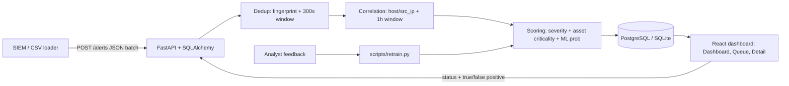
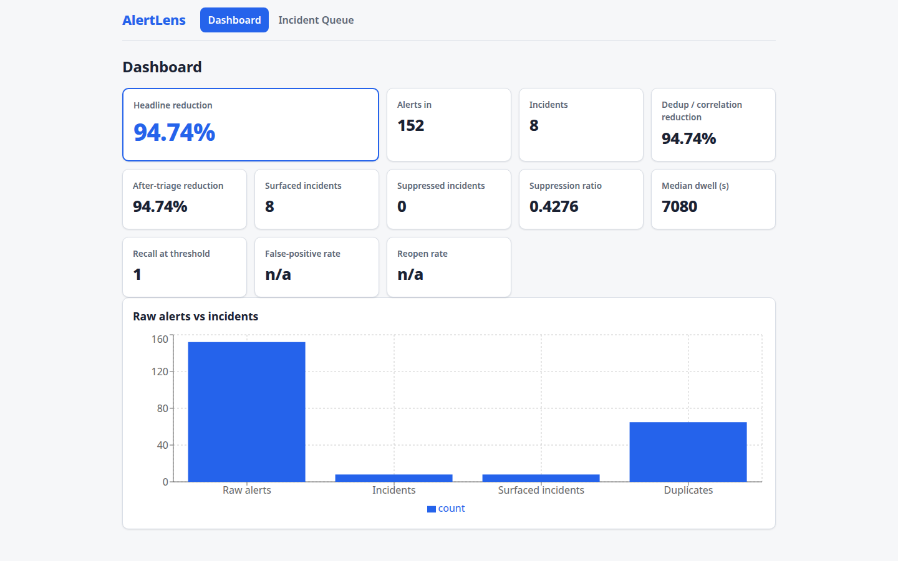
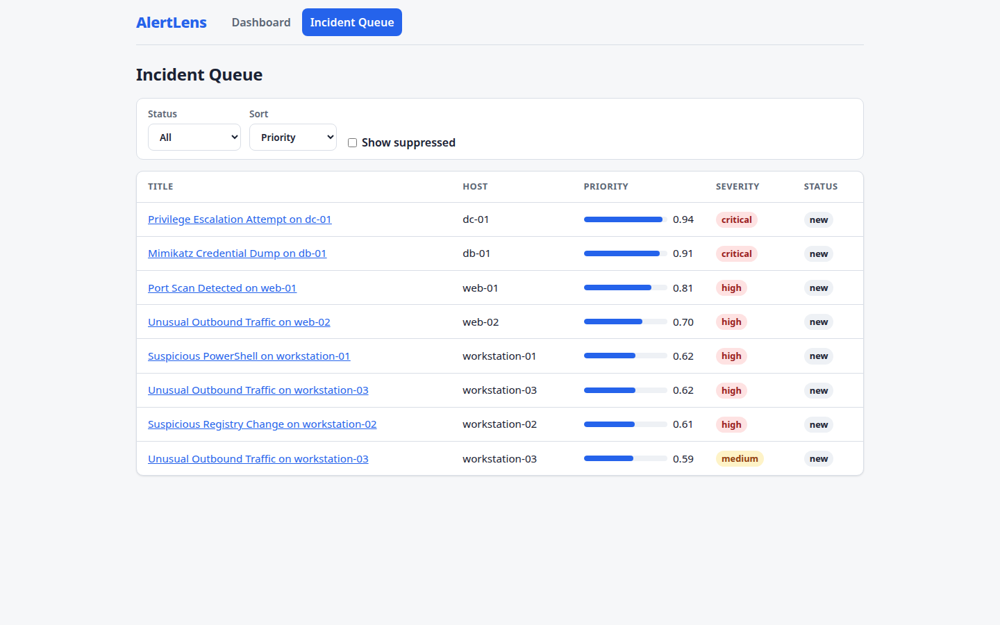
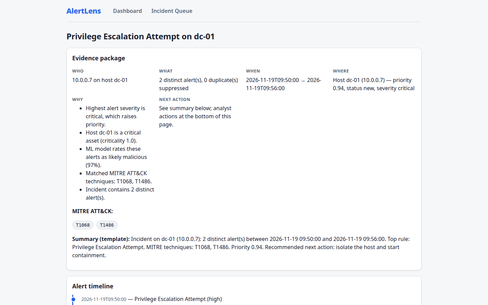
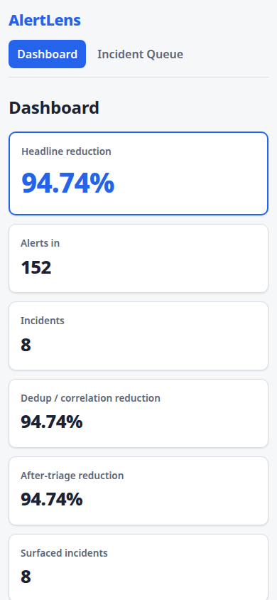
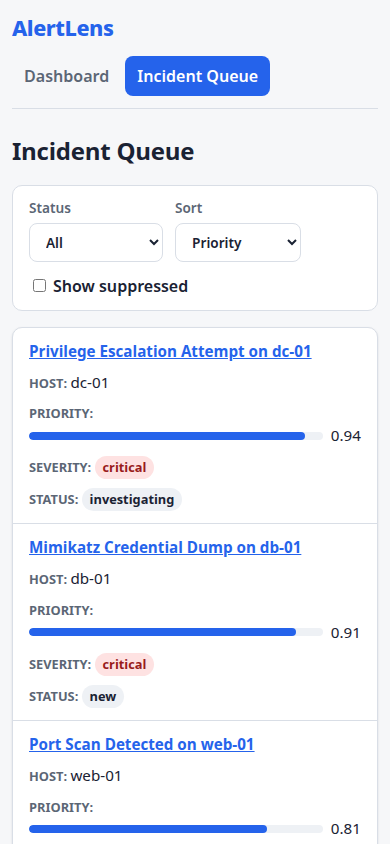

# AlertLens — SOC Alert Triage and Deduplication Dashboard  


**Assumptions (one line):** Seeded/demo data is synthetic and labelled, the ML model trains on synthetic UNSW-NB15-style flows when the real dataset file is absent, and the LLM summary is off by default.

AlertLens ingests noisy security alerts, deduplicates and correlates them into **incidents**, prioritizes **incidents** (not single alerts) under an explicit false-negative budget, and hands the analyst a short evidence package: who / what / when / where / why / next action.

## Problem

SOC analysts drown in alerts. Most of the noise is the same detection firing again and again, or several detections that are really one attack seen from different angles. Triaging alert-by-alert wastes the scarcest resource — analyst attention — and the alerts that matter get buried. AlertLens attacks the volume at the incident level: suppress exact repeats, group what belongs together, score the group, and show the evidence needed to decide in one screen.

## Related Work

Only the sources below are cited. Industry sources are labelled non-peer-reviewed; no other papers or statistics are claimed.

- **Devo, "The Evolution Toward an Alertless SOC" (2025, industry, non-peer-reviewed).** Wakefield Research survey of 200 US SOC professionals (28 Jan–10 Feb 2025, released 16 Apr 2025): 83% of analysts are overwhelmed by alert volume, false positives and missing context; 85% spend significant time collecting and linking evidence. (The brief's claim that under one third use AI for automated triage was **not independently verified** and is stated here only as a brief claim, not as a Devo figure.)
- **François Labrèche (Sophos), "A Needle in a Haystack: Identifying an Infostealer Attack Through Trillions of Events in a Large-scale Modern SOC", NorthSec 2026, Montreal, May 2026 (industry research, non-peer-reviewed; Sophos blog version).** Multi-stage pipeline: detectors, dedup + correlation, suppression, then supervised ML prioritization. After dedup/correlation, 9.5% of alerts remained. The idea of prioritizing *grouped incidents* rather than individual alerts is this project's gap framing, not a quoted Sophos claim.
- **Koumourou et al. (2025, peer-reviewed conference paper).** S. Koumourou, A. Peratikou, E. Stavrou, S. Theodoulou, S. Stavrou, "Reducing SOC Analysts Alert Fatigue via Real-Time CTI Correlation and Deduplication", in *International Conference on Critical Information Infrastructures Security (CRITIS 2025)*, Springer LNCS, Oct 2025, pp. 20–35, DOI: 10.1007/978-3-032-19540-1_2.

**Gaps AlertLens addresses:** (1) incident-level prioritization, (2) an explicit false-negative budget (recall target) with auditable suppression — nothing is ever deleted, duplicates are linked and counted, (3) a decision-ready evidence package per incident.

## Architecture



## Design decisions

- **Incidents, not alerts.** Scoring and the queue operate on incidents; an alert storm becomes one row.
- **Nothing is ever deleted.** Duplicates stay in the database with `is_duplicate=true` and `duplicate_of_id`, so suppression is auditable and reversible.
- **Recall budget before reduction.** The suppression threshold is calibrated on a validation split as the *highest* threshold whose malicious recall still meets `RECALL_TARGET` (default 95%). Alert reduction is reported *after* that constraint, never the other way round.
- **Small, hand-made MITRE map (12 rules).** Auditable by an analyst; a generated map nobody can review would be worse.
- **Deterministic summary by default.** The template summary always works. The LLM path needs `LLM_ENABLED=true` plus a key, and any failure or timeout falls back to the template (recorded as `summary_source`).
- **SQLite for local dev/tests, PostgreSQL in Docker/CI.** Same SQLAlchemy models; tests run without Docker.
- **Simple code over clever code.** Small modules, type hints and docstrings on public functions, pure functions (`dedup_batch`, `correlate`) that are easy to unit-test.

## Pinned versions and support status (checked 2026-11-19)

| Component | Pinned | Support status |
|---|---|---|
| Python | 3.11 | Security-only until 31 Oct 2027 — still supported; plan the upgrade before then |
| PostgreSQL | 17 (`postgres:17`) | Supported until 8 Nov 2029 |
| Node | 24 LTS | Supported until 30 Apr 2028 (Node 22 ends 30 Apr 2027, so it was not used) |
| React | 19 | Current major |
| Vite | 7 | Needs Node 20.19+/22.12+; Node 24 fits |

Local verification in this workspace ran on Python 3.12.3 and Node 24.22.1 (the pinned versions are what Docker/CI use).

## Quickstart

```bash
cp .env.example .env          # set a real API_KEY
make install                  # venv + pip install; frontend npm install
python scripts/generate_synthetic.py   # writes data/sample_alerts.csv (152 alerts, now with a raw flow column), data/synthetic_flows.csv, data/scenarios.csv (300 scenarios)
make train                    # trains model, calibrates threshold (default recall target 0.95)
make run                      # API on http://localhost:8000
# in another shell:
API_URL=http://localhost:8000 API_KEY=<your key> python scripts/load_csv.py data/sample_alerts.csv
cd frontend && npm run dev    # UI on http://localhost:5173
```

Docker (all three services):

```bash
docker compose up --build
# API http://localhost:8000, UI http://localhost:5173
```

UNSW-NB15 (optional, real data): get it from UNSW Canberra (https://research.unsw.edu.au/projects/unsw-nb15-dataset) or Kaggle ("UNSW-NB15"), save the testing set as `data/unsw-nb15.csv` (do not commit it), then `python scripts/make_alerts_from_unsw.py` writes `data/unsw_alerts.csv` and `python scripts/train.py` trains on it. Without the file, training and evaluation use the synthetic fallback and say so; nothing is ever downloaded.

## API

All endpoints except `GET /health` require header `X-API-Key: <API_KEY>`. Rate limit: 60 requests/minute per key (429 beyond it; `RATE_LIMIT_PER_MINUTE` overrides).

| Method | Path | Description |
|---|---|---|
| GET | /health | Liveness, no auth |
| POST | /alerts | Ingest a JSON batch (max 1000); idempotent on alert `id` |
| GET | /incidents?status=&sort=&include_suppressed= | List incidents, filter by status, sort by `priority` or `recent`; suppressed incidents hidden by default, shown with `include_suppressed=true` |
| GET | /incidents/{id} | Evidence package + alert timeline |
| PATCH | /incidents/{id}/status | `new` / `in_triage` / `investigating` / `resolved`; clears suppression (an analyst who moves an incident has looked at it) |
| POST | /incidents/{id}/reopen | Reopen a suppressed incident: status back to `new`, suppression cleared, visible in the queue again |
| POST | /incidents/{id}/feedback | `true_positive` / `false_positive` (+ optional note) |
| GET | /metrics | Dedup/correlation reduction %, after-triage reduction %, headline label, surfaced vs suppressed counts, recall at threshold |

## Metrics definitions

Two reductions are reported separately — conflating them was an old bug:

- **Dedup / correlation reduction %** = `100 * (1 - incidents / alerts)`: what dedup + correlation alone remove from the queue. (Kept as `alert_reduction_pct` too, for compatibility.)
- **After-triage reduction %** = `100 * (1 - surfaced incidents / alerts)`: what the analyst actually has to look at after the recall-budgeted suppression step.
- **Headline reduction** = the after-triage reduction, published **only when `recall_at_threshold >= recall_target`** (default 0.95). When recall is below target the headline is the string `"target not met"` and `headline_reduction_pct` / `after_triage_reduction_pct` are null — the dashboard shows "target not met" instead of a number. Reduction is never reported ahead of the false-negative budget.
- **Suppression ratio** = duplicates / total alerts.
- **Surfaced / suppressed incidents** = incidents with the suppression flag off / on. Suppression hides an incident from the default queue (`GET /incidents`); it never deletes anything. Reopen (`POST /incidents/{id}/reopen`) or a status change clears it.
- **Median dwell** = median (incident last_seen − first_seen) in seconds.
- **False-positive rate** = false-positive feedback / all feedback (null until feedback exists).
- **Reopen rate** = incidents back in triage/investigating / resolved incidents (null until a resolution exists).
- **Recall at threshold** = malicious incidents with ML probability ≥ threshold / all labelled malicious incidents. It is measured on the suppression decision itself (the `suppressed` flag), not on a re-computed probability.

## Evaluation

All numbers below are measured by `python benchmark.py` (see `RESULTS.md` for the verbatim output). Every evaluation number is labelled with its data source; nothing is presented as production performance.

- **Incident-level, not alert-level.** Scoring, threshold calibration and recall are all measured on incidents: an incident is one scenario's alerts on one host (multi-host chains split per host, one incident per host, each carrying the scenario's label).
- **Part A — demo pipeline (synthetic seeded set).** `data/sample_alerts.csv` (152 alerts) through the real ingest pipeline with the portable synthetic fallback model — trained in memory on `generate_synthetic_flows(2000, seed=42)` with its own threshold calibrated on the matching synthetic validation split (threshold 0.1539): 8 incidents (8 surfaced, 0 suppressed), 65 duplicates, headline 94.74%, recall 1.0, precision 0.5. The demo set is a pipeline check, not a performance claim. A work copy with a UNSW-NB15-trained model (`models/model.pkl` present) scores the same demo set differently — 6 surfaced, 2 suppressed, headline "target not met", recall 0.75 — because the model and threshold differ; see `RESULTS.md` for the split.
- **Part B — 5-seed scenario evaluation (synthetic scenario set, harder generator).** For each seed 0–4, `generate_scenarios(300, seed)` produces 300 labelled scenarios (140 malicious) including hard cases — benign admin PowerShell storms, scheduled-backup bursts, low-severity first-stage attacks, multi-host chains — split 60/20/20 stratified by `is_malicious` (train/val/test). A flow model trains on `generate_synthetic_flows(2000, seed)` (flow-level training); each val/test incident is scored by noisy-OR pooling its alerts' ML probabilities; the threshold is calibrated on VAL incidents with `calibrate_incident_threshold` (target 0.95) and evaluated on TEST incidents. The generator now uses **overlapping** flow distributions (malicious `sttl` ~ N(90,45) vs benign ~ N(200,60); malicious `rate` 1–800 vs benign 0.1–400; ~15% of malicious scenarios use benign-like flows and ~10% of benign scenarios use malicious-like flows). AlertLens: mean test recall **0.9419 ± 0.0699**, precision **0.6451 ± 0.0943**, after-triage reduction **70.02% ± 5.68%**; pooled test recall 147/156 = **0.9423** with a 95% Wilson interval of **[0.894, 0.9694]**. The recall target was **not met** on test in seeds 2 (0.9032) and 3 (0.8387) — reported honestly; the generator was not tuned to pass. **Upper-bound caveat:** the generator and the model share the same flow distributions, so Part B numbers are an upper bound on what the same approach would do on truly unseen distributions.
- **Part C — UNSW-NB15-derived evaluation (flow-level, test only).** The UNSW-NB15 file (`data/unsw-nb15.csv`, 175,341 rows, 119,341 malicious, 45 columns) is split stratified 60/20/20 with fixed seed 42 (train 105,204 / val 35,068 / test 35,069). Features are the real UNSW columns `dur, sbytes, dbytes, rate, sttl, ct_srv_src` in a saved sklearn Pipeline (imputer + scaler + GradientBoosting) — no zero-fill, no clipping. Threshold 0.6332 calibrated on val (recall 0.9503, target met), reported on **test flows only**: recall **0.9486** (95% Wilson [0.9458, 0.9514]), precision **0.9334**, reduction **30.83%**. The target was **not met** on test — 22,643 of 23,869 malicious test flows surfaced, target not met. Part C is flow-level, not incident-level, and is reported separately, never merged into the synthetic claims. Note the two UNSW thresholds are different on purpose, not a mistake: 0.6332 is calibrated inside Part C itself (its own model trained on the 60% train split, calibrated on the 20% val split), while 0.6278 in `models/threshold.json` is the saved model's threshold written by `scripts/train.py` (80/20 split) and used by Part A in the work copy — see `RESULTS.md` for the full reconciliation. **These Part C numbers were measured in the work-copy run** (where `data/unsw-nb15.csv` exists); the portable build in this zip ships no dataset file, so Part C is **NOT RUN** there — run `python benchmark.py` in a copy with the dataset file present to reproduce it. Citation: Moustafa and Slay (2015), "UNSW-NB15: a comprehensive data set for network intrusion detection systems", MilCIS 2015. The alert stream is built by `scripts/make_alerts_from_unsw.py` (175,341 alerts, 119,341 malicious); the file has no `srcip`/`dstip` columns, so `src_ip`/`dst_ip` there are deterministic placeholder 10.x.y.z addresses hashed from the row id — identifiers only, never model features.
- **Data-source labels.** Part A uses the seeded demo set (synthetic); Part B uses the synthetic scenario set; Part C is UNSW-NB15-derived (flow-level, test only).

## Baselines

Same val calibration (0.95 recall target) and same test incidents as Part B above; all numbers are means ± std over 5 seeds on TEST incidents (synthetic scenario set):

| Method | Recall | Precision | After-triage reduction | Recall target met (all seeds) |
|---|---|---|---|---|
| AlertLens (noisy-OR pooled ML prob) | 0.9419 ± 0.0699 | 0.6451 ± 0.0943 | 70.02% ± 5.68% | **No — failed in seeds 2, 3** |
| Mean pooling (mean alert ML prob) | 0.9419 ± 0.0803 | 0.7256 ± 0.1108 | 73.55% ± 3.21% | **No — failed in seeds 0, 3** |
| Severity-only (max severity weight) | 1.0000 ± 0.0000 | 0.4937 ± 0.0035 | 59.18% ± 2.36% | Yes |

On this harder set neither ML pooling method meets the recall target — mean pooling ties noisy-OR on recall (0.9419 each) and beats it on precision (0.7256 vs 0.6451), failing in seeds 0 and 3 while noisy-OR fails in seeds 2 and 3 — so under overlapping flows noisy-OR has no advantage over the mean; the pooling choice is a wash on recall. The honest conclusion is that overlapping flow distributions defeat ML-only separation at the 0.95 recall budget; severity-only still meets recall (1.0000) but at precision 0.4937: it surfaces roughly half the benign incidents too, and reduces the queue far less (59.18%). The hard set defeats ML separation, not severity-only recall — severity-only's weakness is precision, not recall.

## Results

The table below is measured: `python benchmark.py` was run in the extracted portable build, and the full verbatim output is in `RESULTS.md`. Re-run it yourself with the same command to reproduce it.

| Metric | Value |
|---|---|
| Alerts in (Part A, demo set) | 152 |
| Incidents out | 8 (8 surfaced, 0 suppressed) |
| Duplicates suppressed | 65 |
| Dedup / correlation reduction % | 94.74 |
| After-triage reduction % (headline) | 94.74% (recall 1.0) |
| Recall / precision (Part A) | 1.0 / 0.5 |
| Dedup latency | 6.258 ms/alert (varies run to run) |
| Incident-level recall, 5 seeds (Part B, synthetic scenario set) | 0.9419 ± 0.0699 — target NOT met (seeds 2, 3) |
| Incident-level precision, 5 seeds | 0.6451 ± 0.0943 |
| Incident-level after-triage reduction, 5 seeds | 70.02% ± 5.68% |
| Pooled test recall + 95% Wilson interval | 0.9423, [0.894, 0.9694] |
| Flow-level recall, UNSW-NB15 test flows (Part C, work-copy run only) | 0.9486, Wilson [0.9458, 0.9514] — target NOT met |
| Flow-level precision / reduction, UNSW-NB15 test (Part C, work-copy run only) | 0.9334 / 30.83% |

## Screenshots

Captured by `npm run screenshots` (see `docs/SCREENSHOTS.md` for the full set with explanations). The seeded run shows 152 alerts collapsed into 8 incidents (8 surfaced, 0 suppressed), headline 94.74%, recall 1.0 — the portable synthetic fallback model.


*Dashboard: KPI hero with the headline reduction, plus the raw-alerts-to-incidents chart.*


*Incident queue: incidents sorted by priority, with host, priority bar and severity/status badges.*


*Incident detail: evidence package (Who/What/When/Where/Why/Next action), MITRE chips and alert timeline.*


*Dashboard on a 390px phone: KPI cards stack, no horizontal scroll.*


*Queue on a 390px phone: the table becomes stacked cards with labelled fields.*

## Limitations

- The seeded dataset and the scenario training data are **synthetic**. The portable build in this zip ships **no trained model** (`models/model.pkl` is excluded): at first load the API trains a synthetic model in memory and calibrates its own threshold on a deterministic synthetic train/validation split (seed 42) — it never reuses the threshold of any other model. With the real UNSW-NB15 file present (`data/unsw-nb15.csv`, loaded by `scripts/train.py`; alerts built by `scripts/make_alerts_from_unsw.py`), `python scripts/train.py` trains a model on real flows instead; that is the optional work-copy evaluation, reported separately. The Part B scenario generator and the model share distributions, so Part B is an upper bound, and the 0.95 recall target is **not met** on the harder synthetic set (seeds 2 and 3) or on the UNSW-NB15 test flows (0.9486 — target not met, measured in the work-copy run). Demo-set precision is modest (0.5 on the demo set).
- Flow fields (`dur`, `sbytes`, `dbytes`, `rate`, `sttl`, `ct_srv_src`) come from the alert's `raw` payload when the SIEM provides them. A missing flow field is `NaN`, median-imputed inside the saved sklearn Pipeline — never zero-filled, never clipped. Alerts that arrive with no flow data at all are never scored by the model (ml_probability is None) and are never suppressed — "no evidence, no suppression" — and the evidence package says "No flow evidence was available for these alerts, so the ML model did not score them."; the model is trained with 25% of rows having a random proper subset of flow columns blanked (label kept) so that partial missingness is in-distribution. No IP-derived features are used anywhere: source/destination IPs are identifiers, never model inputs.
- The MITRE map covers 12 rules only; unmapped rules get no technique tag.
- Correlation is by host/src_ip within a 1-hour window — a slow, multi-day attack chain spanning hosts will split, and a multi-host chain splits into one incident per host (each carrying the chain's label in evaluation).
- No authentication beyond the API key; this is a single-team demo, not a multi-tenant product.
- The LLM summary path has **not been run** (no key supplied); it is code only, never presented as a live result.

## Security notes (OWASP Top 10 mapping)

- **Broken Access Control (A01):** every endpoint except `/health` requires the `X-API-Key` header; missing/wrong key → 401.
- **Injection (A03):** all database access goes through SQLAlchemy ORM / parameterized queries; no string-built SQL anywhere.
- **Security Misconfiguration (A05):** secrets live only in `.env` (never committed; `.env.example` is a template), debug/reload off in Docker, CORS restricted to the local dev UI origin.
- **Vulnerable Components (A06):** pinned dependencies in `requirements.txt` / `package.json`; CI runs lint + tests on every push.
- **Identification/Auth Failures (A07):** single shared API key is a deliberate demo simplification — documented as a limitation, not production auth. The key is fail-fast: when `ENV != "dev"` and no real `API_KEY` is set, the process refuses to start instead of running with a placeholder. Key comparison uses `hmac.compare_digest` (constant time). The frontend never sees a key: the browser calls same-origin `/api` and nginx injects `X-API-Key` server-side.
- **Software/Data Integrity (A08):** no deserialization of untrusted data; model files are loaded only from the local `models/` directory.
- **Logging/Monitoring (A09):** ingest counts and metrics are exposed via `/metrics`; failures return structured 4xx errors (401/404/422/429) instead of stack traces.
- **SSRF (A10):** the only outbound call is the optional LLM request to `api.openai.com`, behind the `LLM_ENABLED` flag with a 5-second timeout and a template fallback.

## How to demo (5 steps)

See `DEMO.md` for the full script. In short: (1) show the seeded CSV and its two duplicate storms + three attack chains, (2) load it and watch 152 alerts collapse to 8 incidents in the Dashboard, (3) open the top incident and read its evidence package aloud, (4) mark one incident false positive and show the metrics move, (5) run `python benchmark.py` live and read the numbers — including the 5-seed baseline table, where AlertLens fails the recall target in seeds 2 and 3 and mean pooling fails in seeds 0 and 3, and the UNSW-NB15 Part C (0.9486, target not met).

## AWS deploy note (docs only, not deployed)

EC2 free tier (t2.micro/t3.micro) + RDS PostgreSQL free tier: run the API container on EC2 with `DATABASE_URL` pointing at RDS, put the built frontend (`npm run build`) behind the same host or S3 + CloudFront, keep the API key in EC2 environment variables (never in the image), and open only ports 80/443 in the security group. No deployment has been performed; this is a plan, not a claim.

## Non-goals

User accounts, multi-tenancy, Kafka/streaming, Kubernetes, mobile, real SIEM connectors, custom deep learning, websockets.
