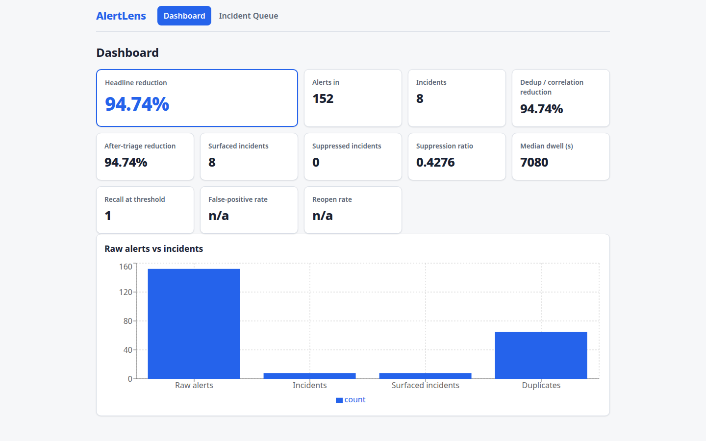
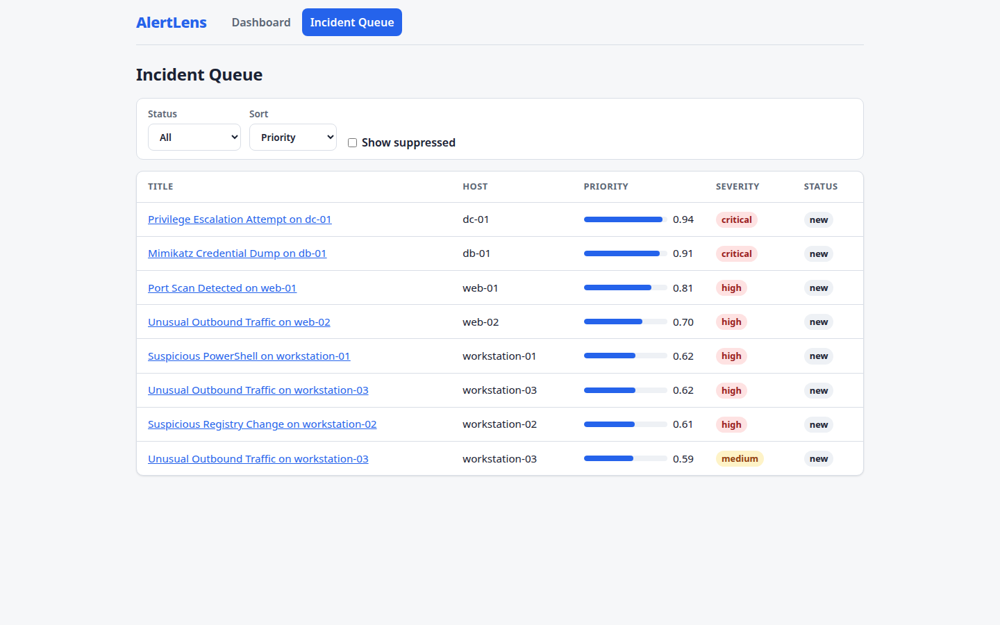
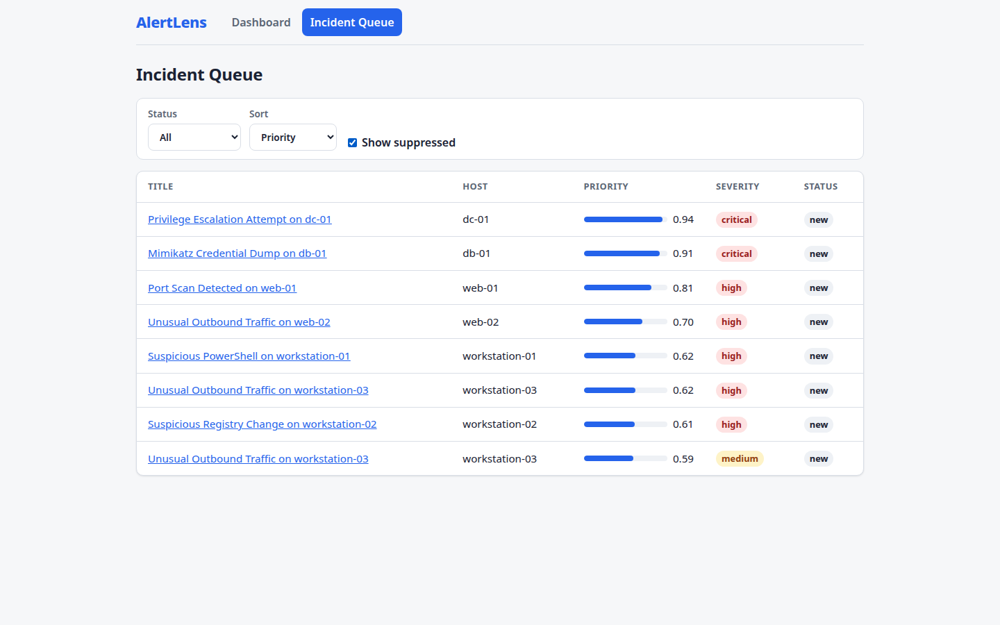
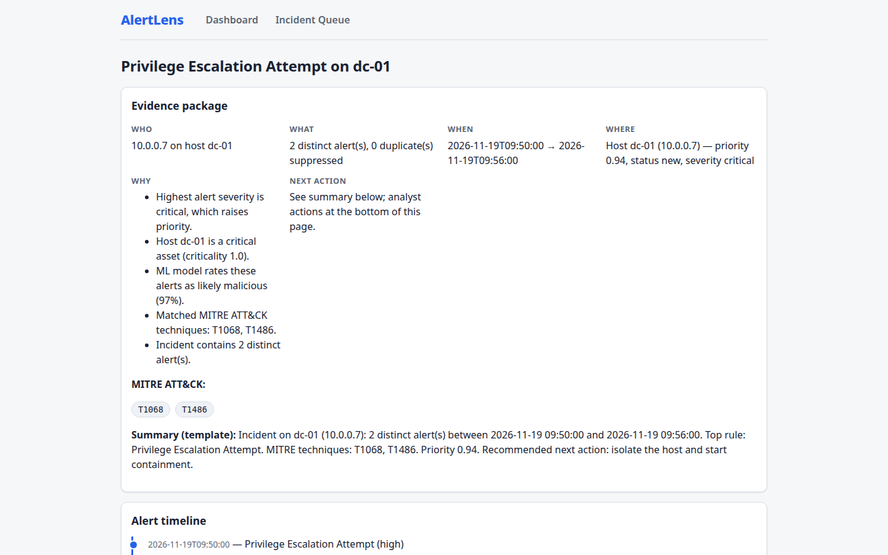
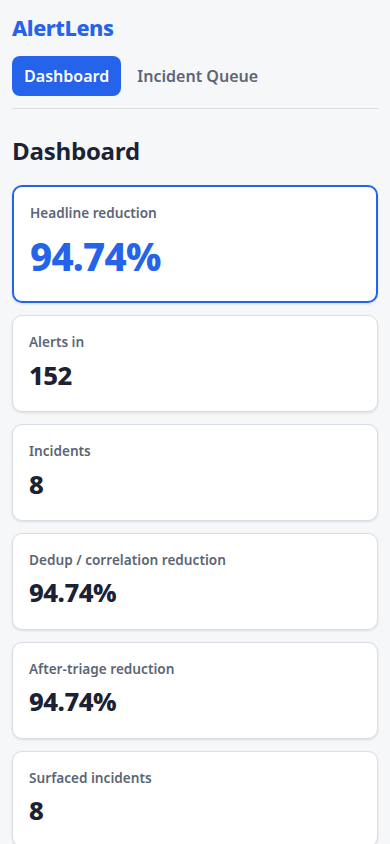
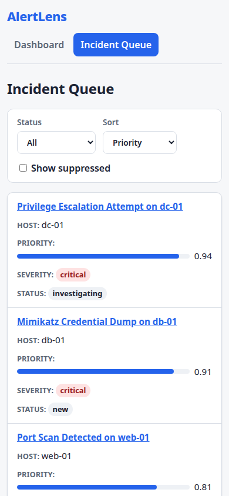
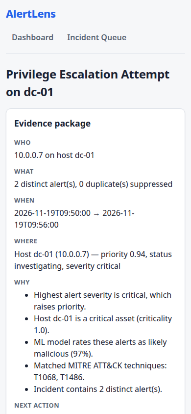

# AlertLens — screenshots

Captured by `npm run screenshots` (frontend/scripts/capture-screenshots.mjs) against a
temp SQLite database seeded from `data/sample_alerts.csv` with a known API key. All
numbers below come from live `/metrics` and `/incidents` responses in that run —
nothing here is hardcoded.

Seeded run: 152 alerts collapsed into 8 incidents (8 surfaced, 0 suppressed); headline reduction 94.74%; recall at threshold 1.
Top incident after feedback: "Privilege Escalation Attempt on dc-01" is now investigating with analyst label true_positive; dashboard after feedback still shows 8 incidents (8 surfaced).

## Dashboard — desktop

The KPI grid leads with the headline reduction (94.74%) and the counts behind it — 152 raw alerts, 8 incidents, 8 surfaced and 0 suppressed. An analyst sees in one glance how much noise was removed and whether the recall target was met; the chart below makes the raw-alerts-to-incidents funnel concrete.

## Incident queue — desktop

The queue is the working list: 8 surfaced incidents sorted by priority, each with a host, a priority bar, and severity/status badges. Sorting by priority instead of time is the point of the product — the most dangerous incident is first, not the loudest alert.

## Queue — show suppressed

No incident was suppressed in this seeded run, so the "Show suppressed" toggle reveals the same queue with nothing muted — the toggle exists for runs where the threshold does hide incidents, and suppression is auditable, not deletion: an analyst can find and reopen anything the threshold hid, which is what makes the false-negative budget trustworthy.

## Incident detail

The evidence package for the top incident ("Privilege Escalation Attempt on dc-01", priority 0.94) answers who, what, when, where and why on one screen, with MITRE ATT&CK chips and a vertical alert timeline. That is the whole triage decision in one place — Devo's survey found analysts spend most of their time assembling exactly this, so the product assembles it for them.

## Incident detail — after feedback

The same incident after an analyst marked it true positive and moved it to investigating. Feedback is stored per incident and feeds the retrain script, so the next calibration learns from this environment's benign behaviour instead of only from synthetic data.

## Dashboard — after feedback

The dashboard after the feedback action: the queue counts are unchanged in shape (8 incidents, 8 surfaced), but the false-positive rate and reopen rate now reflect a real analyst decision — the metrics are a live view of the queue, not a static report.

## Dashboard — mobile (390px)

The same dashboard at 390px wide: KPI cards stack in one column and the chart card keeps a minimum width so it never renders at zero width. A SOC analyst checking the queue on a phone still sees the headline number first, with no horizontal scrolling.

## Queue — mobile (390px)

The queue at 390px: the table becomes stacked cards, one per incident, with the title, host, priority bar and badges still legible. Triage on a small screen stays possible because the layout adapts instead of shrinking the table.

## Incident detail — mobile (390px)

The evidence package at 390px: sections stack, MITRE chips wrap, and the timeline stays vertical. Nothing is cut off — the analyst can still read the why and act on it.
